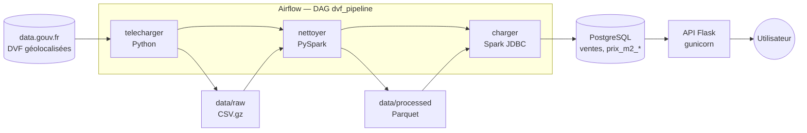

# DVF Pipeline — Prix de l'immobilier en France

[](https://github.com/thasedasaidani/dvf-pipeline/actions/workflows/ci.yml)


Pipeline data de bout en bout sur les **Demandes de Valeurs Foncières** (DVF), le registre
public de toutes les ventes immobilières en France : ingestion depuis data.gouv.fr,
nettoyage et calcul du prix au m² avec **PySpark**, stockage dans **PostgreSQL**,
orchestration avec **Airflow**, exposition via une **API Flask**, le tout lancé avec
**Docker Compose**.

```bash
curl "http://localhost:8000/prix?commune=Juvisy-sur-Orge&type=Appartement&annee=2025"
```
```json
{"commune": "Juvisy-sur-Orge", "nb_resultats": 1, "resultats": [{"annee": 2025,
 "type_local": "Appartement", "nb_ventes": 143, "prix_m2_median": 3493.98, "prix_m2_moyen": 3439.12, "...": "..."}]}
```

## Architecture



| Conteneur | Rôle |
|---|---|
| `postgres` | base métier : tables DVF nettoyées |
| `airflow-db` | base interne d'Airflow, séparée des données métier |
| `airflow` | Airflow 3 + Java + PySpark, exécute le DAG |
| `api` | API Flask (image légère, sans Spark), utilisateur non-root |

## Lancement en une commande

Prérequis : Docker Desktop (6 Go de mémoire minimum, 8 Go pour la France entière).

```bash
git clone https://github.com/thasedasaidani/dvf-pipeline.git && cd dvf-pipeline
make up        # construit et lance PostgreSQL, Airflow et l'API
make run       # déclenche le pipeline (Essonne, 2 ans) — suivi sur http://localhost:8080
```

Puis http://localhost:8000/prix?commune=Juvisy-sur-Orge. `make help` liste toutes les commandes
(`make run-france` pour la France entière sur 5 ans, `make psql`, `make down`...).

## Résultats

| Périmètre | Lignes DVF brutes | Ventes retenues | Durée du DAG |
|---|---|---|---|
| Essonne (91), 2024–2025 | — | 24 546 | 1 min 46 (dont 1 min 07 de Spark) |
| France entière, 5 ans | _à compléter_ | _à compléter_ | _à compléter_ |

Exécution sur un MacBook, Spark en mode local dans le conteneur Airflow.

## Étapes du pipeline

### 1. Ingestion — `src/ingestion/download_dvf.py`
Télécharge les fichiers DVF géolocalisés (Etalab) des N dernières années, pour la France
ou un département. Années détectées automatiquement, fichiers déjà présents ignorés,
écriture atomique (`.part` puis renommage) pour ne jamais laisser de fichier corrompu.

### 2. Transformation — `src/transform/clean_dvf.py` (PySpark)
- Doublons exacts supprimés, seules les mutations de type « Vente » sont gardées.
- **Piège DVF** : une vente peut compter plusieurs lignes qui répètent toutes le prix
  total. On ne garde que les ventes d'**un seul logement** (appartement ou maison),
  dépendances autorisées, sinon le prix au m² serait faux.
- Surface habitable entre 9 et 1 000 m², prix entre 500 et 25 000 €/m².
- Conversions tolérantes (`try_cast`) : une valeur illisible est écartée au lieu de faire
  échouer le job (Spark 4 est en mode ANSI strict).
- Agrégats : nombre de ventes, médiane et moyenne du prix au m², par année × commune × type
  et par année × département × type. Sortie en Parquet.

### 3. Chargement — `src/load/load_postgres.py`
Connecteur JDBC de Spark, en `overwrite` + `truncate` : relançable sans doublons, et le
schéma de `sql/init.sql` (clés primaires, index) est conservé. Contrôle qualité : une
table vide après chargement fait échouer la tâche.

| Table | Contenu |
|---|---|
| `ventes` | une ligne par vente de logement nettoyée |
| `prix_m2_commune` | nb de ventes, prix au m² médian et moyen par année × commune × type |
| `prix_m2_departement` | idem par année × département × type |

### 4. Orchestration — `dags/dvf_pipeline.py` (Airflow 3)
**telecharger → nettoyer → charger**, exécution mensuelle (DVF est mis à jour deux fois
par an), 2 relances automatiques par tâche, paramètres `dept` et `years` modifiables au
lancement.

### 5. API — `src/api/` (Flask)

| Endpoint | Description |
|---|---|
| `GET /prix?commune=Juvisy-sur-Orge` | prix au m² médian/moyen et nb de ventes, par année et type |
| `GET /prix?commune=...&type=Appartement&annee=2025` | idem, filtré |
| `GET /departements/91` | chiffres du département |
| `GET /communes?q=juv` | recherche de communes (autocomplétion) |
| `GET /health` | état de l'API et de la base |

Erreurs en JSON : 400 (paramètre invalide), 404 (aucune donnée), 503 (base indisponible).
Requêtes SQL paramétrées. Le nombre de ventes accompagne toujours le prix : une médiane
calculée sur 40 ventes est moins fiable que sur 400.

## Qualité

- **Tests** (`pytest`) : règles de nettoyage Spark, téléchargement, configuration JDBC,
  API (avec un faux dépôt de données, sans base), structure du DAG.
- **Intégration continue** : GitHub Actions lance les tests et construit l'image de l'API
  à chaque push.
- Secrets dans `.env` (non versionné), modèle dans `.env.example`.

## Développement local (sans Docker)

```bash
make install && source .venv/bin/activate      # Python 3.12, Java 17+ requis pour Spark
cp .env.example .env
python -m src.ingestion.download_dvf --dept 91 --years 2
python -m src.transform.clean_dvf
docker compose up -d postgres && python -m src.load.load_postgres
flask --app src.api.app run --port 8000
make test
```

## Structure

```
dags/                 DAG Airflow
src/ingestion/        téléchargement DVF
src/transform/        nettoyage et agrégats PySpark
src/load/             chargement PostgreSQL (JDBC)
src/api/              API Flask
sql/init.sql          schéma de la base
docker/               Dockerfiles Airflow et API
tests/                tests pytest
```

## Données

Source : DGFiP, *Demandes de valeurs foncières* géolocalisées par Etalab — Licence Ouverte 2.0.
Conformément au décret 2018-1350, les données ne doivent pas être utilisées pour
ré-identifier les personnes concernées par les ventes.
