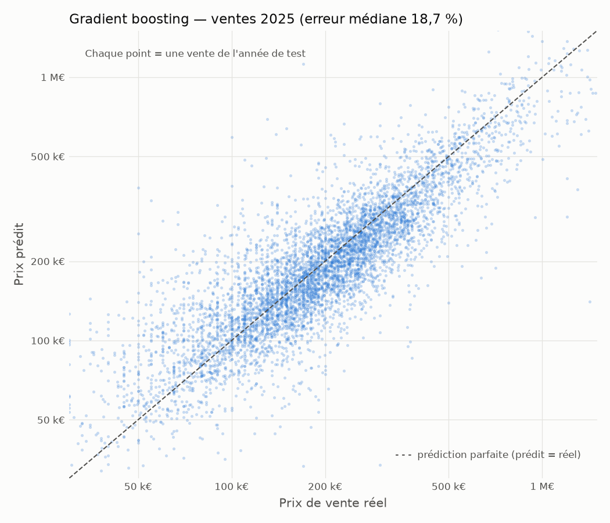

# Prédiction du prix d'un logement — résultats

Entraînement sur 2021–2024 (1 000 000 ventes), test sur 2025 (250 000 ventes jamais vues par le modèle).

| Modèle | Erreur médiane | Erreur moyenne | Ventes à ±10 % | Ventes à ±20 % |
|---|---|---|---|---|
| Référence (médiane commune × surface) | 20,1 % | 30,7 % | 26,8 % | 49,7 % |
| Régression linéaire (Ridge) | 19,7 % | 29,4 % | 27,0 % | 50,6 % |
| Gradient boosting | 18,7 % | 28,1 % | 28,5 % | 52,9 % |

Meilleur modèle : **Gradient boosting**, erreur médiane de **18,7 %** (1,4 point(s) de mieux que la référence).

*Erreur médiane : la moitié des ventes est estimée avec un écart inférieur à ce pourcentage. L'erreur moyenne est plus élevée car quelques ventes atypiques pèsent lourd.*
